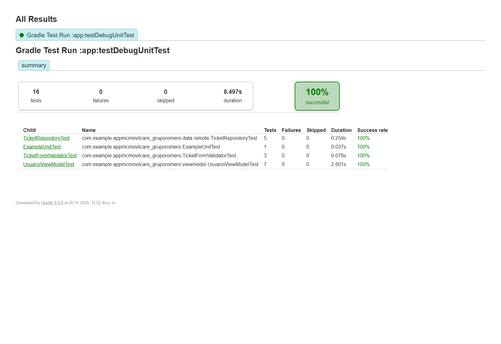
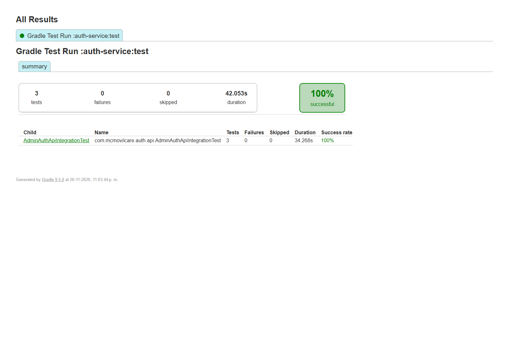
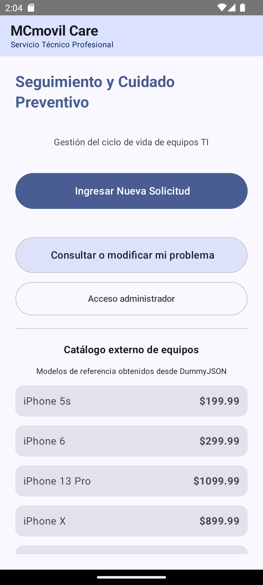

# Evidencias de evaluación

Proyecto individual de Anthony Alexander Romero Bracamonte. Esta página organiza los reportes generados y señala qué evidencia debe incorporarse al documento de entrega.

## Pruebas automatizadas

Las pruebas se reejecutaron el 26 de noviembre de 2026. Gradle terminó con `BUILD SUCCESSFUL`: 31 pruebas, 0 fallos y 0 omitidas.

| Módulo | Pruebas | Fallos | Reporte HTML |
|---|---:|---:|---|
| Android | 16 | 0 | [`app/build/reports/tests/testDebugUnitTest/index.html`](../app/build/reports/tests/testDebugUnitTest/index.html) |
| Autenticación | 3 | 0 | [`auth-service/build/reports/tests/test/index.html`](../auth-service/build/reports/tests/test/index.html) |
| Tickets | 12 | 0 | [`backend/build/reports/tests/test/index.html`](../backend/build/reports/tests/test/index.html) |

Capturas listas para adjuntar al PDF:

- Android: 
- Autenticación: 
- Tickets: 

Los informes HTML originales están bajo `build/` y se regeneran localmente; no se incluyen en el repositorio Git.

## Cobertura JaCoCo

Los tres informes HTML se generaron y las verificaciones de cobertura finalizaron con éxito. Los umbrales configurados son de al menos 80% en las clases de lógica seleccionadas por cada módulo; no representan una afirmación de 80% para todo el código fuente.

- Android: [`app/build/reports/jacoco/jacocoDebugUnitTestReport/html/index.html`](../app/build/reports/jacoco/jacocoDebugUnitTestReport/html/index.html)
- Autenticación: [`auth-service/build/reports/jacoco/test/html/index.html`](../auth-service/build/reports/jacoco/test/html/index.html)
- Tickets: [`backend/build/reports/jacoco/test/html/index.html`](../backend/build/reports/jacoco/test/html/index.html)

Los resúmenes agregados muestran 97% de cobertura de líneas en Android, 97% en autenticación y 96% en tickets. Los umbrales de 80% se aplican a las clases de lógica indicadas en la configuración de cada módulo.

Capturas listas para adjuntar al PDF:

- Android: 
- Autenticación: 
- Tickets: 

Para volver a generar los reportes y comprobar sus umbrales desde PowerShell:

```powershell
.\gradlew.bat '--rerun-tasks' ':app:testDebugUnitTest' ':app:jacocoDebugUnitTestReport' ':auth-service:test' ':auth-service:jacocoTestReport' ':backend:test' ':backend:jacocoTestReport'
.\gradlew.bat ':app:jacocoDebugUnitTestCoverageVerification' ':auth-service:jacocoTestCoverageVerification' ':backend:jacocoTestCoverageVerification'
```

## Consumo de API externa

La captura se obtuvo desde la aplicación en el emulador y muestra productos de DummyJSON cargados en el catálogo:



Archivo para adjuntar al documento: [`docs/evidencias/catalogo-api-emulador.png`](evidencias/catalogo-api-emulador.png).

La compilación `debug` actual también se instaló y abrió en el emulador conectado el 26 de noviembre de 2026; el catálogo se muestra cargado desde DummyJSON. Captura de esa ejecución: . Esta captura acredita la ejecución de `debug`, no el APK `release`.

## APK de release y llave de firma

El APK local `app/build/outputs/apk/release/app-release.apk` tiene una firma válida v2, pero el archivo existente fue generado el 25 de noviembre de 2026, antes de los cambios actuales del código. La regeneración se intentó el 26 de noviembre y falló en `validateSigningRelease` con `Keystore file not set for signing config release`: no están configuradas las variables `RELEASE_KEYSTORE`, `RELEASE_KEY_ALIAS`, `RELEASE_STORE_PASSWORD` y `RELEASE_KEY_PASSWORD`. Por tanto, el archivo actual no debe presentarse como el APK final de esta revisión. El almacén `app/signing/mcmovilcare-release.jks` existe localmente y está excluido de Git; no se debe publicar ni incluir en capturas su contenido o contraseñas.

Cuando se genere el APK final, adjunta una captura de `apksigner verify --verbose --print-certs` ejecutado sobre ese mismo archivo, junto con una captura del nombre/ruta del almacén `.jks` sin abrirlo. Conserva el almacén y sus credenciales en un medio privado.

## Foto tomada con cámara

Esta evidencia aún debe añadirse: no se generó una foto real desde este entorno y solo había un emulador conectado, no un teléfono físico. En el teléfono, abre el formulario de una solicitud, pulsa **Tomar foto de evidencia**, toma y confirma la foto, y verifica que la miniatura quede adjunta antes de capturar la pantalla. La imagen de evidencia debe mostrar la foto adjunta a la solicitud; no reemplazarla por una imagen de galería si la pauta exige demostrar el uso de cámara.

## Presentación y documentación

- Para las capturas de la app, usa una imagen tomada desde el emulador o recorta el escritorio para mostrar solo la aplicación; oculta correos personales y no alteres los resultados.
- Incluye en el documento de entrega los enlaces al [README](../README.md) y a la [documentación técnica](TECNICA.md).
- La captura del catálogo guardada aquí no muestra datos personales ni la marca de activación de Windows.
- Adjunta en AVA el PDF/captura de Trello que ya tienes en Descargas; no lo copies a GitHub porque contiene un enlace de invitación. La carga en AVA y la activación individual requieren tu cuenta y deben completarse personalmente.