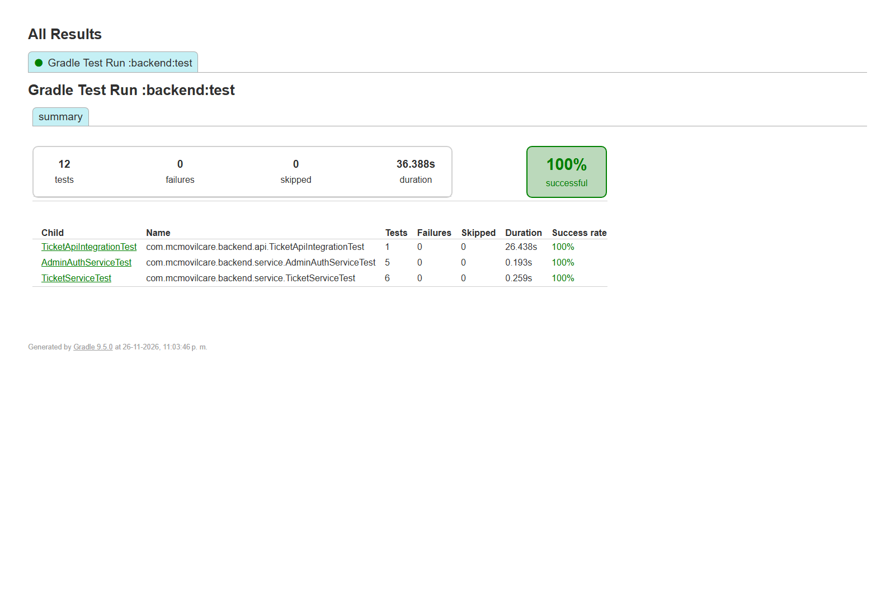
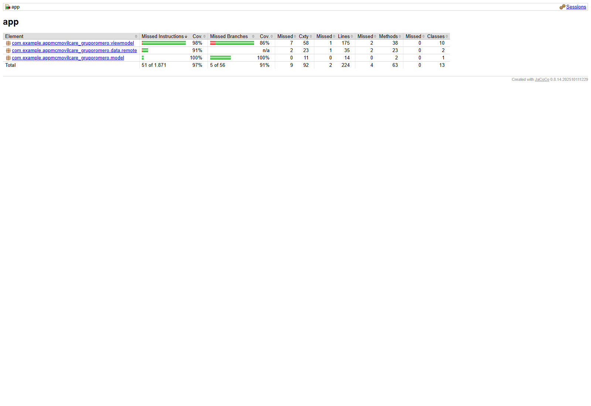
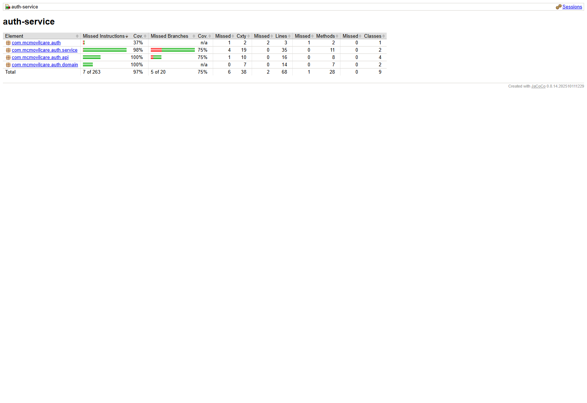
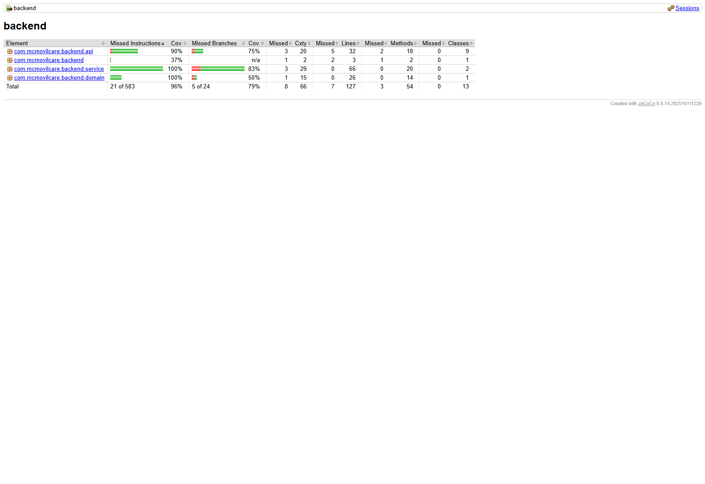

# Evidencias de evaluación

Proyecto individual de Anthony Alexander Romero Bracamonte. Esta página organiza los reportes generados y señala qué evidencia debe incorporarse al documento de entrega.

## Pruebas automatizadas

Los reportes HTML incluidos corresponden a la ejecución del 26 de noviembre de 2026. El 27 de noviembre se volvió a ejecutar `gradlew.bat check` desde la carpeta de entrega y terminó con `BUILD SUCCESSFUL`: 31 pruebas, 0 fallos y 0 omitidas.

| Módulo | Pruebas | Fallos | Reporte HTML |
|---|---:|---:|---|
| Android | 16 | 0 | [Reporte HTML](reportes/android/pruebas/index.html) |
| Autenticación | 3 | 0 | [Reporte HTML](reportes/autenticacion/pruebas/index.html) |
| Tickets | 12 | 0 | [Reporte HTML](reportes/tickets/pruebas/index.html) |

Capturas listas para adjuntar al PDF:

- Android: 
- Autenticación: 
- Tickets: 

Se incluyen copias HTML de los informes en `docs/reportes/` para consulta sin compilar. Al ejecutar las pruebas, Gradle vuelve a generar los informes de trabajo bajo `build/`.

## Cobertura JaCoCo

Los tres informes HTML se generaron y las verificaciones de cobertura finalizaron con éxito. Los umbrales configurados son de al menos 80% en las clases de lógica seleccionadas por cada módulo; no representan una afirmación de 80% para todo el código fuente.

- Android: [Reporte JaCoCo](reportes/android/cobertura/index.html)
- Autenticación: [Reporte JaCoCo](reportes/autenticacion/cobertura/index.html)
- Tickets: [Reporte JaCoCo](reportes/tickets/cobertura/index.html)

Los resúmenes agregados muestran 97% de cobertura de líneas en Android, 97% en autenticación y 96% en tickets. Los umbrales de 80% se aplican a las clases de lógica indicadas en la configuración de cada módulo.

Capturas listas para adjuntar al PDF:

- Android: 
- Autenticación: 
- Tickets: 

Para volver a generar los reportes y comprobar sus umbrales desde PowerShell:

```powershell
.\gradlew.bat '--rerun-tasks' ':app:testDebugUnitTest' ':app:jacocoDebugUnitTestReport' ':auth-service:test' ':auth-service:jacocoTestReport' ':backend:test' ':backend:jacocoTestReport'
.\gradlew.bat ':app:jacocoDebugUnitTestCoverageVerification' ':auth-service:jacocoTestCoverageVerification' ':backend:jacocoTestCoverageVerification'
```

## Consumo de API externa

La captura se obtuvo desde la aplicación en el emulador y muestra productos de DummyJSON cargados en el catálogo:


Archivo para adjuntar al documento: [`docs/evidencias/catalogo-api-emulador.png`](evidencias/catalogo-api-emulador.png).

La compilación `debug` actual también se instaló y abrió en el emulador conectado el 26 de noviembre de 2026; el catálogo se muestra cargado desde DummyJSON. Captura de esa ejecución: . Esta captura acredita la ejecución de `debug`, no el APK `release`.

## APK de release y llave de firma

La captura de PowerShell aportada el 27 de noviembre de 2026 muestra el APK `app/build/outputs/apk/release/app-release.apk` con fecha de modificación `27-11-2026 0:15:09`, tamaño de 46.902.443 bytes y resultado `Verifies`; `Verified using v2 scheme: true` confirma que la firma v2 de ese archivo es válida. Esto acredita la variante `release` y su firma, pero no sustituye una prueba de instalación y ejecución de ese APK.

La captura se recibió en la conversación, pero aún no está guardada en `docs/evidencias/` ni incorporada al PDF de entrega. Añádela al documento bajo el título **Verificación de firma del APK Release** y entrega junto con ella el APK final. El almacén de firma y sus contraseñas deben conservarse en privado; no los publiques en GitHub ni los muestres en la captura.

## Foto tomada con cámara

Esta evidencia aún debe añadirse: no se generó una foto real desde este entorno y solo había un emulador conectado, no un teléfono físico. En el teléfono, abre el formulario de una solicitud, pulsa **Tomar foto de evidencia**, toma y confirma la foto, y verifica que la miniatura quede adjunta antes de capturar la pantalla. La imagen de evidencia debe mostrar la foto adjunta a la solicitud; no reemplazarla por una imagen de galería si la pauta exige demostrar el uso de cámara.

## Presentación y documentación

- Para las capturas de la app, usa una imagen tomada desde el emulador o recorta el escritorio para mostrar solo la aplicación; oculta correos personales y no alteres los resultados.
- Incluye en el documento de entrega los enlaces al [README](../README.md) y a la [documentación técnica](TECNICA.md).
- La captura del catálogo guardada aquí no muestra datos personales ni la marca de activación de Windows.
- Adjunta en AVA el PDF/captura de Trello que ya tienes en Descargas; no lo copies a GitHub porque contiene un enlace de invitación. La carga en AVA y la activación individual requieren tu cuenta y deben completarse personalmente.